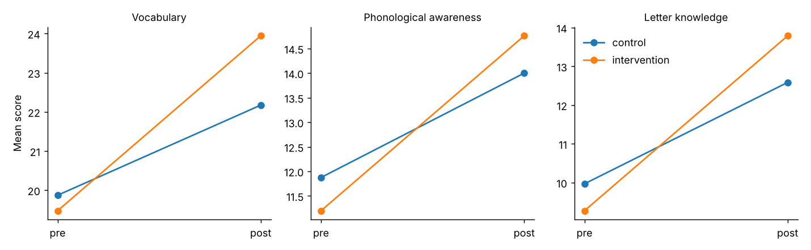

# Education survey data pipeline: Excel workbooks → validation → consolidated dataset

A small, reproducible pipeline (Python and R) that reads many Excel workbooks
submitted by different schools, checks them against validation rules, consolidates
them into one clean dataset and produces a quality-control report and summary
statistics.

## Background

This repository reproduces, **with synthetic data**, the data workflow I used in the
PREVENIR kindergarten language and literacy study (Universitat Oberta de Catalunya),
whose results were published in:

- Peñaherrera, E., et al. (2025). *Effects of a multitiered system of language support on
  preliteracy abilities in kindergarten children with Developmental Language Disorder.*
  JSLHR, 68(11). https://doi.org/10.1044/2025_JSLHR-25-00211
- Balboa-Castells, R., Peñaherrera, E., et al. (2026). *PREVENIR: An oral language
  intervention for preventing reading difficulties in kindergarten children.* LSHSS, 57(2).
  https://doi.org/10.1044/2025_LSHSS-25-00052

In that study, assessment data arrived as separate Excel workbooks per school and
assessment wave. The real data are about children and cannot be shared, so this
repository uses a generator that creates workbooks with the same structure and
injects typical data-entry errors. **No real participant data is included.**

## What it does

```
data/raw/school_S01.xlsx ... school_S12.xlsx      (metadata + pre + post sheets)
        │
        ▼  pipeline/read.py         read every workbook, check sheets and columns,
        │                            keep source file and Excel row for traceability
        ▼  pipeline/validate.py     apply rules from config/validation_rules.csv:
        │                            missing IDs, duplicates per wave, score ranges,
        │                            age range and age vs. school-year cohort checks
        ▼  pipeline/consolidate.py  one row per child and wave; failing values set to
        │                            missing (never silently dropped), QC status per school
        ▼  pipeline/report.py       consolidated.csv, issues_log.csv, qc_summary.csv,
                                     qc_report.html, pre/post chart
R/analysis.R                         same consolidation in R (readxl, dplyr) and a
                                     pre/post ANCOVA per measure (lm(post ~ pre + group))
```

Design choices:

- **Rules as data.** Validation rules and age cohorts live in CSV files in `config/`,
  so a methodologist can review or change them without editing code.
- **Traceability.** Every issue points to the source file and Excel row, so it can be
  sent back to the school (or country) that submitted it.
- **Nothing is silently changed.** Values are only set to missing when an error rule
  fails, and every change appears in the issues log.
- **Tested.** `tests/` checks the main rules and the consolidation logic.

## Run it

```bash
pip install -r requirements.txt
python scripts/generate_synthetic_data.py --out data/raw   # 12 synthetic school workbooks
python -m pipeline --input data/raw --output outputs        # validate + consolidate + report
Rscript R/analysis.R data/raw outputs                       # R consolidation + ANCOVA
pytest -q
```

Or simply `make all`. R packages: readxl, dplyr, tidyr, purrr, readr, ggplot2.

## Example output

QC status by school (`docs/example_outputs/qc_summary.csv`):

| school_id | records | errors | warnings | status |
|---|---|---|---|---|
| S01 | 33 | 3 | 0 | needs follow-up |
| S02 | 50 | 0 | 1 | passed |
| … | | | | |



## Author

Esteban Peñaherrera, PhD · [ORCID 0000-0001-9360-9816](https://orcid.org/0000-0001-9360-9816)
